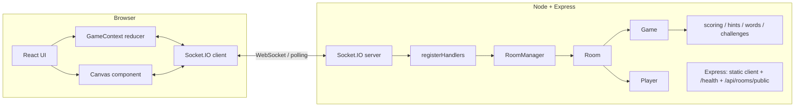

# PRD: Doodle Dash — a skribbl.io-style Multiplayer Drawing & Guessing Game

> Source of truth: the Web3Task assignment PDF "Intern Assignment: skribbl.io Clone".
> Anything in this PRD marked **[PDF]** comes straight from the PDF. Anything marked **[OURS]** is an addition or a decision we made. Where the PDF is ambiguous or contradicts itself, it is listed in Section 5.2 instead of being silently changed.

---

## 0. How to Read This Document (for the AI coding agent)

- Build **in stages** (see `24_HOUR_PLAN.md`). Do not build everything at once.
- **MUST-HAVE** items are the minimum complete submission. Do not start SHOULD/NICE/BONUS/OURS items until the MUST-HAVE core flow (create room → draw → guess → score → winner) works locally.
- The server is the **single source of truth** for game state, timers, word, and scores. The client only displays state and sends intents.
- Keep code simple and readable. The developer is a fresher who must explain every file in an interview.
- Working rules for the agent are in **Appendix B**. Follow them in every task.

---

## 1. Project Title and Overview

**Product name:** Doodle Dash (working title; may be renamed).

**One-liner:** A free, browser-based multiplayer game where one player draws a secret word on a shared canvas while everyone else races to guess it.

**Overview [PDF]:** Players join a room (public or private). Each round, one player draws a chosen word; others guess. Correct guesses earn points; the player with the most points at the end wins. Turns rotate so everyone draws.

**Our differentiators [OURS]:**
- **Feature A – Drawing Challenge Cards:** optional drawer challenges (two colors only, one continuous stroke, speed draw, honor-system challenge).
- **Feature B – Progressive Hints:** letters of the word are revealed gradually by the server.
- **Feature C – Streak Bonus:** bonus points for consecutive correct guesses.

---

## 2. Problem Statement and Objective

**Problem:** The company wants proof that the candidate can build and deploy an end-to-end real-time application: WebSockets, canvas drawing, server-side game logic, and deployment.

**Objectives:**
1. Deliver a working, publicly deployed skribbl.io clone whose core flow works in production **[PDF]**.
2. Deliver `README.md` with setup steps and the live URL, plus an architecture overview **[PDF]**.
3. Make the candidate able to explain strokes, game state, WebSockets, word matching and deployment **[PDF: Code Understanding]**.
4. Stand out with three polished extra features and a product-quality UI **[OURS]**.

**Non-goals:** accounts/login, database, payments, native mobile apps, image-recognition or AI verification of drawings, multi-server scaling.

---

## 3. Target Users and User Stories

**Users:** (1) Casual players who want a quick game with friends via a link; (2) the host who configures and starts a game; (3) the evaluator who tests the app in 5–10 minutes with 2–3 tabs/devices.

| ID | Story | Priority |
|----|-------|----------|
| US1 | As a host, I create a room with settings and share a link/code. | MUST |
| US2 | As a player, I join via link or code with a nickname. | MUST |
| US3 | As a player, I see who is in the lobby and who is ready. | MUST |
| US4 | As a host, I start the game when enough players are ready. | MUST |
| US5 | As a drawer, I pick a word and draw it with a brush, colors, undo and clear. | MUST |
| US6 | As a guesser, I see the drawing live and type guesses. | MUST |
| US7 | As a player, I earn points for correct guesses and see a leaderboard. | MUST |
| US8 | As a player, I see the winner and final leaderboard at game end. | MUST |
| US9 | As a guesser, I see a countdown and progressive letter hints. | SHOULD (PDF) / MUST (ours, Feature B) |
| US10 | As a guesser, I earn bonus points for streaks. | OURS (Feature C) |
| US11 | As a drawer, I can accept a challenge card for a bonus. | OURS (Feature A) |
| US12 | As a player, I can browse and join public rooms. | SHOULD (see 5.2) |
| US13 | As a host, I can kick a disruptive player. | NICE |

---

## 4. Complete Feature Requirements (extracted from the PDF)

### 4.1 Core Requirements [PDF]
1. Multiplayer rooms – create or join; public and private.
2. Turn-based drawing – one drawer per round; others guess.
3. Real-time drawing – canvas updates in real time for all viewers via WebSockets.
4. Word system – drawer picks a word from a list; others see hints or blanks.
5. Scoring – points for correct guesses; leaderboard; winner at game end.
6. WebSockets – real-time sync for drawing, guesses, chat and game state.

### 4.2 Room & Lobby [PDF]
Create room with settings (player count, rounds, draw time, etc.); join via link or code; lobby shows players, **ready-up**, host starts game; private room = invite-only via link; public room = join random/open rooms (optional).

### 4.3 Game Flow [PDF]
Word selection (1 of N, N = 1–5) → drawing (strokes sync in real time) → guessing (first correct guess gets points) → hints (optional, reveal letters over time) → round end (time out or word guessed; next drawer; next round) → game end (winner + leaderboard).

### 4.4 Drawing Tools [PDF]
Brush/pen with color; multiple colors; brush size thin/thick; eraser; undo last stroke; clear canvas (drawer only).

### 4.5 Chat & Guessing [PDF]
Guess input checked against the word; general chat (drawer sees after round, or all can chat); "PlayerX guessed the word!" notification; hint display (e.g., after 30 s, 60 s).

### 4.6 Room Settings (host-configurable) [PDF]
| Setting | Range |
|---|---|
| Max players | 2–20 |
| Rounds | 2–10 |
| Draw time | 15–240 seconds |
| Word count | 1–5 choices per round |
| Hints | 0–5, or disabled |
| Word mode | Normal, Hidden (no word shown), Combination (optional) |

### 4.7 Tech Stack [PDF] and our choice [OURS]
PDF allows React/Next.js/Vue, Canvas/Fabric/Konva, Node (Express) or FastAPI, Socket.IO or ws. **We use the PDF's "recommended stack":** React + TypeScript + Vite, HTML5 Canvas with custom drawing logic, Node.js + Express, Socket.IO.

### 4.8 Deployment [PDF]
Public, fully working; Render / Railway / Vercel (+ separate WebSocket backend) / Netlify (+ separate backend). Live URL in README. Core flow must work in production.

### 4.9 Deliverables [PDF]
Working app (local + deployed); `README.md` (setup + live URL); architecture overview (how WebSockets, canvas and game logic integrate); code-walkthrough readiness.

### 4.10 Bonus ideas [PDF]
OOP structure for the WebSocket server (Room, Game, Player, MessageHandler classes); configurable room settings; word modes; moderation (kick, ban, votekick, report); custom word list; avatars; spectator mode; replay last round.

---

## 5. Priority Matrix

### 5.1 Matrix (PDF priority preserved; our plan in the last column)

| Requirement | PDF priority | Our plan |
|---|---|---|
| Create room with configurable settings | MUST | Build (Phase 1) |
| Join via link or code | MUST | Build |
| Lobby with player list; host starts game | MUST | Build |
| Turn-based rounds: one drawer, others guess | MUST | Build |
| Real-time drawing sync | MUST | Build |
| Word selection for drawer (1–5 choices) | MUST | Build |
| Guessing + points for correct guess | MUST | Build |
| Scoring and leaderboard | MUST | Build |
| Game end with winner | MUST | Build |
| Basic drawing tools: brush, colors, undo, clear | MUST | Build |
| Hints (reveal letters over time) | SHOULD | Build (= Feature B) |
| Chat (guesses + optional general chat) | SHOULD | Build (guess input is also chat) |
| Draw time countdown | SHOULD | Build (needed anyway for rounds) |
| Private rooms (invite link) | SHOULD | Build (cheap: `isPublic` flag + link) |
| Word categories | NICE | JSON organised by category; UI display optional |
| Eraser tool | NICE | Build (cheap; also listed in Drawing Tools table) |
| Kick/ban | NICE | Kick only, if time |
| Votekick | NICE | Postpone |
| Multiple languages for word list | NICE | Postpone |
| Public room browsing ("join random/open rooms") | optional in Room table | Build simple list if time (SHOULD in our plan) |
| Ready-up in lobby | Room & Lobby table | Build |
| Word modes: Normal | Room Settings table | Build (default) |
| Word mode: Hidden | Room Settings table | Build if time (cheap) |
| Word mode: Combination | "(optional)" + Bonus | Postpone |
| OOP server classes | BONUS | Build (it is just good structure) |
| Custom word list, avatars, spectator, replay, votekick, report, ban | BONUS | Postpone |
| Feature A Challenge Cards | OURS | Build after core + B + C |
| Feature B Progressive Hints | OURS (matches PDF "Should") | Build |
| Feature C Streak Bonus | OURS | Build |

### 5.2 Places where the PDF's priorities overlap or disagree (not silently changed)
1. **Hints:** "Optional" in Game Flow, "Should Have" in the checklist, and 0–5 hints configurable in Room Settings. Core Requirement 4 says others "see hints **or blanks**" (blanks = must; letter hints = should).
2. **Private/public rooms:** Core Requirement 1 says "support public and private rooms" (core), the checklist lists **private rooms as Should Have**, and the Room table calls public rooms "(optional)". We implement both as an `isPublic` flag; the public-room list is a small extra.
3. **Eraser:** listed in the Drawing Tools table (no label) but "Nice to Have" in the checklist. We build it because it is cheap.
4. **Chat:** Core Requirement 6 includes chat over WebSockets; the checklist says "Should Have (guesses + optional general chat)". Guessing is MUST; general chat is SHOULD.
5. **Room settings:** MUST ("Create room with configurable settings") but also repeated under BONUS ("Room settings – draw time, rounds, word count, hints (all configurable)"). We treat settings as MUST.
6. **Word modes:** in the Room Settings table (Combination "optional") and again in BONUS. Normal = MUST, Hidden = cheap extra, Combination = postponed.
7. **Draw time:** the countdown is "Should Have", yet a draw-time setting (15–240 s) is required and rounds must end when time runs out, so a server timer is effectively MUST. The visible countdown UI is built together with it.
8. **Moderation:** Nice to Have lists kick/ban/votekick; BONUS adds report. We do kick only, if time.
9. **PDF event payload vs. secrecy:** the suggested `game_state` payload contains `word`, and `round_start` carries `wordOptions` for all clients. Sending these to everyone would leak the word. We send `word`/`wordOptions` **only to the drawer's socket** (see Section 16 and 17). This is a deliberate, explained deviation.
10. **`draw_data` "including drawer":** the PDF suggests broadcasting strokes back to the drawer too. We instead broadcast to everyone **except** the drawer (the drawer already rendered locally; this avoids double drawing and lag). The server stores every stroke, so a `canvas_sync` event can rebuild the canvas for anyone. This is a deliberate deviation.

---

## 6. Detailed Game Flow

**States (server `Game.phase`):** `LOBBY → WORD_SELECTION → DRAWING → ROUND_END → (WORD_SELECTION … ) → GAME_OVER`.

1. **Landing:** user enters nickname, chooses **Create Room** or **Join Room** (code input) or **Browse public rooms**. If the URL is `/room/ABC123`, the join form is pre-filled.
2. **Create:** host sets settings → server creates room with a 6-character code → host lands in the Lobby. Share link = `https://<site>/room/<CODE>`.
3. **Lobby:** players join (name de-duplicated). Non-host players toggle **Ready**. Host can edit settings. Host's **Start Game** is enabled when ≥ 2 players are connected and every non-host player is ready.
4. **Start:** server freezes the **turn order** (join order), sets `round = 1`, `turnIndex = 0`. **A "round" = every player draws once.** Total turns = rounds × players. The room is **locked to new joins** once the game starts (late-joining is out of scope; reconnecting players are allowed).
5. **Word selection (15 s):** server picks `wordCount` random unused words and sends them **only to the drawer**. If Feature A is on, the drawer also sees a challenge card and may accept/skip it (Section 13.4). Others see "X is choosing a word…". If the drawer does not choose in 15 s, the server auto-picks the first option.
6. **Drawing:** server starts the draw timer (`drawTime`, or shorter for the speed challenge). Guessers see blanks (e.g., `_ _ _ _ _`); the drawer sees the real word. Drawer draws; strokes stream to everyone.
7. **Guessing:** guessers type into the guess box. First correct guess and subsequent ones are scored (Section 13). A correct guesser's input is then locked for the round.
8. **Hints:** at server-scheduled times letters are revealed (Section 13.3).
9. **Round end** when (a) the timer hits 0, or (b) all connected guessers have guessed correctly, or (c) the drawer disconnects. Server reveals the word, applies end-of-turn logic (streak resets, drawer points), shows a 5 s round summary.
10. **Next turn:** next drawer in the order; when everyone has drawn, `round++`.
11. **Game over:** after the last turn of the last round, server sends the winner and leaderboard. Host can click **Play Again** (returns everyone to the lobby with scores reset).

---

## 7. Screen-by-Screen UI Requirements

### 7.1 Landing page
- Hero with logo/wordmark, one-line tagline, animated doodle illustration (CSS/SVG only).
- Nickname input (1–20 chars).
- Primary button **Create Room**; secondary **Join with Code** (code input); text link **Browse public rooms**.
- Small "How to play" strip (3 steps with icons).
- Footer: GitHub link.

### 7.2 Create Room modal/page
Fields: Max players (2–20), Rounds (2–10), Draw time (15–240 s, slider or stepper), Word count (1–5), Hints (0–5), Word mode (Normal/Hidden), Public toggle, Challenge Cards toggle. Defaults: 8 players, 3 rounds, 80 s, 3 words, 2 hints, Normal, Private, Challenges on.

### 7.3 Lobby
- Room code + **Copy link** button (shows "Copied!" feedback).
- Player cards (avatar circle with initial/color, name, HOST badge, READY badge, connection dot).
- Settings summary (host can edit; others read-only).
- **Ready** toggle (non-host) / **Start Game** (host; disabled with a reason tooltip e.g., "Need 2+ players" / "Waiting for everyone to be ready").
- Host-only **Kick** button on player cards (NICE).
- Lobby chat is optional.

### 7.4 Game screen (desktop layout: 3 columns)
- **Top bar:** round `2/3`, timer (progress ring or bar), word display (blanks/hints for guessers; real word for drawer), challenge badge.
- **Left:** live leaderboard (rank, name, score, 🔥 streak badge, ✏️ on the current drawer, ✓ if already guessed this round).
- **Center:** large canvas (fixed 4:3 aspect ratio, scales to container) + toolbar underneath (drawer only, disabled for guessers).
- **Right:** chat/guess panel: message list + input ("Type your guess…").
- **Overlays:** word picker (drawer), "X is choosing…" (others), round summary (word + score changes), challenge card.
- Mobile (< 900 px): stack canvas on top, then tabs/accordion for chat and leaderboard; toolbar scrolls horizontally.

### 7.5 Round summary overlay (5 s)
"The word was **CASTLE**", list of points gained this turn (with streak bonuses), next drawer announcement.

### 7.6 Game over screen
Podium (top 3), winner highlight with confetti-style CSS animation, full leaderboard, **Play Again** (host) and **Leave** buttons.

### 7.7 Global UI
Toast notifications for errors/joins/leaves; connection status banner ("Reconnecting…"); loading spinners; empty states.

---

## 8. Room and Lobby Behavior

- **Room code:** 6 chars from `ABCDEFGHJKMNPQRSTUVWXYZ23456789` (no look-alikes). Server guarantees uniqueness.
- **Join rules:** room must exist; phase must be `LOBBY` (else "Game already in progress", unless reconnecting with a known `sessionId`); room not full; name 1–20 chars, trimmed, HTML not interpreted; duplicate names get a suffix (`Sam`, `Sam 2`).
- **Host:** the creator. If the host leaves/disconnects in the lobby, host passes to the next player. In-game, if the host leaves, host passes on too (so Play Again still works).
- **Public vs private:** both are joinable by code/link. `isPublic: true` rooms appear in `GET /api/rooms/public` (only rooms in `LOBBY`, not full, not empty). Private rooms are never listed.
- **Empty rooms** are deleted 60 s after the last player leaves; all timers are cleared.
- **Reconnect:** client stores `sessionId` in **`sessionStorage`** (per-tab, so two tabs in one browser behave as two different players; it survives a page refresh). On reconnect the server re-binds the new socket to the existing player and sends `room_joined` + `game_state` + `canvas_sync`. A player disconnected for > 30 s in-game is marked `connected: false` and skipped as drawer; they are not deleted from the leaderboard.

---

## 9. Drawing and Canvas Behavior

- **Canvas:** one `<canvas>` with a fixed logical size (800×600). CSS scales it responsively. All coordinates sent over the wire are **normalized (0–1)** relative to the canvas so every screen size renders identically.
- **Tools:** Brush, Eraser, Color palette (12 swatches), Size (thin 4 / medium 10 / thick 20), Undo, Clear.
- **Stroke model:**
  ```ts
  type Stroke = { id: string; tool: 'brush' | 'eraser'; color: string; size: number; points: {x:number;y:number}[] };
  ```
  Eraser strokes are stored as strokes painted in the canvas background color, so undo works uniformly.
- **Capture:** use **Pointer Events** (`pointerdown/move/up/cancel`) with `setPointerCapture` and `touch-action: none` so mouse, touch and pen all work. Convert `clientX/Y` to normalized coordinates using `getBoundingClientRect()`.
- **Sending:** `draw_start {x,y,color,size,tool}` on pointer down; `draw_move {x,y}` while moving (skip points closer than ~0.002 to the last sent point to reduce traffic); `draw_end {}` on pointer up/cancel/leave.
- **Drawer rendering:** the drawer draws locally immediately (optimistic).
- **Viewer rendering:** viewers receive `draw_data` events and draw line segments between consecutive points with `lineCap = 'round'`, `lineJoin = 'round'`.
- **Undo:** server removes the last stroke from the list and broadcasts `draw_undo`; every client **re-renders all remaining strokes** from its local stroke list (clients keep the same list).
- **Clear:** `canvas_clear` wipes strokes on server and clients (drawer only).
- **Late joiners/reconnect:** server sends `canvas_sync {strokes}`.
- **Who may draw:** the server accepts `draw_*` events only if `phase === DRAWING` and `socket.id` is the current drawer. Everything else is silently ignored (and logged in dev).
- **Cleanup:** strokes are cleared at the start of each turn.

---

## 10. Real-Time Socket.IO Communication

- One Socket.IO connection per tab; client uses `io()` with **no URL** (same origin in production; Vite dev-server proxies `/socket.io` to the backend in development, so no CORS or env vars are needed).
- Every room is a Socket.IO room named by its code. Broadcast helpers live in the `Room` class.
- Secret data is emitted **per socket** (`io.to(socketId)`), never to the whole room.
- All handlers validate: payload shape/types, that the socket belongs to a room, that the player has the right role (host/drawer), and that the phase allows the action.
- Basic rate limits per socket: `draw_move` ≤ 120/s, `guess`/`chat` ≤ 5 per 3 s, other events ≤ 10/s. Excess events are dropped.
- Server → client errors use `error_message {code, message}`.

---

## 11. Game State and Turn Management

All state lives in memory on the server in classes:

- **`RoomManager`**: `Map<code, Room>`, create/find/delete rooms, cleanup timers.
- **`Room`**: code, settings, players (`Map<playerId, Player>`), hostId, `game: Game`, `broadcast()` helpers.
- **`Player`**: id, socketId, sessionId, name, score, streak, ready, connected, hasGuessed.
- **`Game`**: phase, turn order, round/turn index, current word, word options, strokes, timers, `correctGuessers` set, hint state, challenge state; methods: `start()`, `beginWordSelection()`, `chooseWord()`, `beginDrawing()`, `handleGuess()`, `endTurn()`, `nextTurn()`, `endGame()`.
- **`registerHandlers` (MessageHandler)**: maps Socket.IO events to Room/Game methods after validation.
- Pure helper modules (easy to unit test): `scoring.ts`, `hints.ts`, `words.ts` (`normalizeGuess`, `pickWords`), `challenges.ts`, `validation.ts`.

**Timers:** exactly one `turnTimer` (setTimeout until end), one `tickInterval` (1 s `timer_tick`), N `hintTimeouts`, one `wordSelectTimeout`. A single `clearTimers()` is called at every phase change, game end and room deletion to prevent leaks and double-ends.

**Turn skipping:** when picking the next drawer, skip players with `connected === false`. If fewer than 2 connected players remain, end the game early and show the leaderboard.

**Idempotent end:** `endTurn()` must return immediately if `phase !== DRAWING` so a simultaneous "all guessed" and "timer expired" cannot award or advance twice.

---

## 12. Word Selection and Guessing

### 12.1 Word list
`server/src/data/words.json`, organised by category:
```json
{ "animals": ["cat","elephant", "..."], "objects": ["lamp","umbrella"], "actions": ["running","swimming"], "food": ["pizza","banana"], "places": ["castle","airport"] }
```
At least ~150 words (30+ per category), common English nouns/verbs, no offensive words. `pickWords(n, usedSet)` returns `n` distinct unused random words; if the pool is exhausted, reset `usedSet`.

### 12.2 Word choice
Drawer sends `word_chosen {word}`. Server verifies the word is one of the options **it sent to that drawer**. Invalid → ignored + error. Timeout → auto-pick.

### 12.3 Guess matching (explainable in interview)
1. `normalizeGuess(text)`: Unicode NFKC → lowercase → trim → replace hyphens/underscores/punctuation with spaces → collapse repeated whitespace.
2. Compare normalized guess to normalized word. **Equal → correct.** (So `"  CaSTle "` = `castle`; `"ice-cream"` = `"ice cream"`.)
3. **Partial / close guess** (not scored): if not equal but Levenshtein distance ≤ 1 and the word has ≥ 5 letters, send a private `guess_result {correct:false, close:true}` to that guesser only ("So close!"). The close guess is **not** shown in public chat so it does not help others.
4. Incorrect guesses are broadcast as normal chat messages `chat_message`.
5. The drawer cannot guess. A drawer message containing the word (normalized) is blocked with an error.
6. A player who has already guessed correctly cannot score again that round; their further messages are shown only to the drawer and other correct guessers (SHOULD; if short on time, simply block their input).

### 12.4 Word display
Guessers: masked string, e.g., `_ _ _ _ _ _`, spaces/hyphens shown as gaps/dashes, plus the length in parentheses `(6)`. Drawer: the real word. Word mode **Hidden**: guessers see only `?` and no letter hints (Hidden disables Feature B). Combination mode is postponed.

---

## 13. Scoring, Hints, Challenge Cards and Streak Bonus

### 13.1 Base scoring (server-authoritative)
- **Guesser base points** = `100 + floor(200 × remainingTime / totalTime)` → between 100 and 300. (Faster = more points.)
- **Drawer points** = `+50` per correct guesser, awarded as each guess lands. Drawer gets 0 if nobody guesses.
- Scores are only modified inside `Game.handleGuess()` and `Game.endTurn()`. There is **no** client event that sets or sends a score. Clients receive scores read-only.
- **Duplicate-scoring guards:** (1) `correctGuessers: Set<playerId>` – a player already in the set is ignored; (2) `phase` must be `DRAWING`; (3) the drawer is never a guesser; (4) `endTurn` is idempotent (Section 11).

### 13.2 Leaderboard
Sorted by score descending; ties share the same rank, then ordered by join order. Winner = top rank (ties: show "It's a tie!" and list co-winners).

### 13.3 Feature B – Progressive Hints
- **Setting:** `hints` = 0–5 (0 = disabled). Disabled automatically in Hidden mode.
- **Effective hint count:** `h = min(settings.hints, floor(wordLetterCount / 2))` so at least half the letters always stay hidden (a 3-letter word gets at most 1 hint; a 1-letter word 0).
- **Schedule:** reveal #k (k = 1..h) happens at `drawTime × k / (h + 1)` seconds after drawing starts. Example: 80 s, h=2 → reveals at ~26.7 s and ~53.3 s. Use the (possibly shortened) actual draw time.
- **Which letters:** at round start the server creates a shuffled list of letter indices (spaces/hyphens excluded) and reveals them in that order. Never reveal all letters.
- **Server logic:** `hints.ts`: `buildMask(word, revealedIndices) → "_ A _ _ E _"`. The server keeps `revealedIndices` in the `Game`; the word itself never leaves the server except to the drawer (and in `round_end`).
- **Secrecy:** each reveal is sent as `hint_update {mask, revealedCount}` containing **only the mask string**, emitted to guessers (every socket in the room except the drawer). The drawer already knows the word. Reconnecting/late-syncing guessers receive the current mask inside `game_state`. The client never receives the raw word or the index list during the turn.
- **UI:** word display animates the newly revealed letter (pop/flip). Aria label reads "6 letters, 2 revealed".

### 13.4 Feature A – Drawing Challenge Cards
- **Setting:** `challengesEnabled` (room-level toggle, default on).
- **When:** at the start of `WORD_SELECTION`, server randomly selects **one** card and sends it to the drawer only (in `round_start`). The drawer chooses **Accept** or **Skip** together with picking the word: `word_chosen {word, acceptChallenge}`. Default (or timeout) = skip.
- **If accepted:** at drawing start the card becomes visible to everyone through `drawing_started.challenge` so guessers can enjoy it (it does not reveal the word).
- **Cards and what is actually enforced:**

| Card ID | Rule | Enforcement | Notes |
|---|---|---|---|
| `TWO_COLORS` | "Use only two colors." | **Server-enforced.** Server tracks the distinct colors used by **brush** strokes (eraser excluded). A `draw_start` with a third distinct color is rejected with `draw_rejected {reason}`. Client also disables the remaining swatches after two are used (UI convenience only). | Undo does not "free up" a color (simple rule: colors used stay used). |
| `ONE_STROKE` | "Draw without lifting the brush." | **Server-enforced.** Only the **first** `draw_start` of the turn is accepted; any later `draw_start` is rejected. **Undo and Clear are disabled** for this card (server rejects them) so the drawer can't reset the allowance. | Pointer leaving the canvas ends the stroke (a lift). |
| `SPEED_DRAW` | "Beat the clock: half the normal time." | **Server-enforced.** The server sets this turn's draw time to `max(15, round(drawTime × 0.5))` and the countdown/hints/scoring all use it. | |
| `HONOR_NO_LETTERS` | "Draw it without any letters or numbers." | **NOT enforced (honor system).** The UI labels it "Honor system" with a distinct badge. No reward is tied to it. | Included on purpose as the example of a self-reported rule; the UI never calls it "verified". |

- **Reward (only for enforced cards):** if the drawer **accepted** an enforced card and **at least one** guesser got the word, the drawer gets **+25** bonus points at turn end (shown in the summary as "Challenge bonus +25"). Honor-system cards give no points. No image recognition is used anywhere.
- **Server state:** `challenge = { id, accepted, enforced, usedColors:Set, strokeCount }`.

### 13.5 Feature C – Streak Bonus
- **Base points:** as in 13.1 (100–300 by speed).
- **Streak definition:** the number of **consecutive turns** in which that player guessed the word correctly. Stored as `player.streak`.
- **Bonus progression** (applied to the guess that makes the streak `n`): `bonus = min(n − 1, 4) × 20`

| Streak after this guess | Bonus |
|---|---|
| 1 | +0 |
| 2 | +20 |
| 3 | +40 |
| 4 | +60 |
| 5 or more | +80 (cap) |

- **When a streak increases:** inside `handleGuess` right after a valid, first correct guess of the turn: `player.streak += 1`, then bonus is computed from the new value.
- **When a streak resets to 0:** at `endTurn()` for every player who was **eligible** (connected at turn start, not the drawer) and did **not** guess correctly this turn. Also reset to 0 on `Play Again`.
- **Neutral cases:** the turn where the player is the drawer does not change their streak. A disconnected player's streak freezes (does not reset) while they are away; joining mid-game is not allowed.
- **Server validation:** the bonus is computed only on the server inside `scoring.ts` (`calcGuessPoints(remaining, total, streak)`), guarded by the `correctGuessers` set so a repeated message cannot add a second bonus.
- **UI:** guess feed shows e.g. `🔥 Sam guessed the word! +240 (+40 streak bonus x3)`; leaderboard shows a 🔥 badge with the streak number when ≥ 2; the round summary lists base + bonus separately. `guess_result` carries `{points, basePoints, streakBonus, streak}`.

---

## 14. Suggested Frontend and Backend Architecture



**Frontend:** React + TS + Vite. State: `useReducer` + React Context (no Redux). One `socket.ts` creates the single socket. A `useSocketEvents` hook in `GameContext` subscribes to every server event and dispatches reducer actions. Pages: Landing, Lobby, Game, GameOver (selected from `state.phase`/`state.roomId`; tiny manual URL parsing for `/room/:code`, no router library needed).

**Backend:** Node + Express + Socket.IO in TypeScript (`tsx` for dev, `tsc` for build). Express serves the built client in production, `GET /health`, and `GET /api/rooms/public`. One Node process, in-memory state.

**Why no database:** rooms are short-lived; word list is a JSON file; nothing must persist.

---

## 15. Suggested Folder Structure

```
doodle-dash/
├── package.json              # root scripts: dev, build, start
├── README.md
├── PRD.md
├── docs/ARCHITECTURE.md      # diagram + explanation
├── client/
│   ├── index.html
│   ├── vite.config.ts        # proxy /socket.io + /api -> http://localhost:3001
│   └── src/
│       ├── main.tsx
│       ├── App.tsx
│       ├── socket.ts
│       ├── types.ts
│       ├── state/GameContext.tsx
│       ├── pages/ (Landing.tsx, Lobby.tsx, GameScreen.tsx, GameOver.tsx)
│       ├── components/ (DrawingCanvas.tsx, Toolbar.tsx, PlayerList.tsx, Leaderboard.tsx,
│       │                ChatPanel.tsx, WordDisplay.tsx, Timer.tsx, WordPicker.tsx,
│       │                ChallengeCard.tsx, RoundSummary.tsx, Toast.tsx)
│       ├── lib/ (canvasRenderer.ts, coords.ts)
│       └── styles/ (tokens.css, base.css, components.css)
└── server/
    ├── package.json
    ├── tsconfig.json
    └── src/
        ├── index.ts              # Express + Socket.IO bootstrap
        ├── config.ts             # constants and limits
        ├── socket/registerHandlers.ts
        ├── game/ (Player.ts, Room.ts, Game.ts, RoomManager.ts)
        ├── lib/ (scoring.ts, hints.ts, words.ts, challenges.ts, validation.ts, rateLimit.ts)
        ├── data/words.json
        └── tests/ (scoring.test.ts, hints.test.ts, words.test.ts)
```

---

## 16. Socket.IO Event Contract

Legend: C→S = client to server, S→C = server to clients (room), S→1 = server to one socket, S→others = room except the drawer.
IDs: `playerId` is a server-generated string; `roomId` is the room code.

### 16.1 Room & Lobby
| Event | Dir | Payload | Validation / notes |
|---|---|---|---|
| `create_room` | C→S | `{hostName, settings}` | name 1–20; settings validated against ranges in 4.6 + `isPublic`, `challengesEnabled`; invalid → `error_message` (or clamp, but be consistent and tell the user). |
| `join_room` | C→S | `{roomId, playerName, sessionId?}` | room exists, phase LOBBY or valid `sessionId` rejoin, not full, name rules. |
| `room_joined` | S→1 | `{roomId, you:{id, sessionId}, players, hostId, settings, phase}` | Sent to the joining socket. |
| `player_joined` | S→others | `{player, players}` | [PDF] |
| `player_left` | S→room | `{playerId, players, hostId}` | [PDF]; includes new host if changed. |
| `players_updated` | S→room | `{players, hostId}` | After ready/connection/score changes. Public player shape: `{id,name,score,streak,ready,connected,isHost,hasGuessed}`. |
| `set_ready` | C→S | `{ready:boolean}` | Lobby only. |
| `update_settings` | C→S | `{settings}` | Host only, LOBBY only. Broadcast `settings_updated {settings}`. |
| `start_game` | C→S | `{}` | Host only; LOBBY; ≥ 2 connected players; all non-host ready. [PDF] |
| `kick_player` | C→S | `{playerId}` | NICE. Host only; not self. Target gets `kicked {}`. |
| `leave_room` | C→S | `{}` | Removes player, may reassign host. |
| `error_message` | S→1 | `{code, message}` | Codes: `ROOM_NOT_FOUND`, `ROOM_FULL`, `GAME_STARTED`, `INVALID_NAME`, `INVALID_SETTINGS`, `NOT_HOST`, `NOT_DRAWER`, `BAD_PHASE`, `RATE_LIMITED`, `INVALID_PAYLOAD`. |

### 16.2 Game State
| Event | Dir | Payload | Notes |
|---|---|---|---|
| `game_state` | S→1 (per player) | `{phase, round, totalRounds, turnIndex, totalTurns, drawerId, wordMask, wordLength, remaining, challenge?, hintsRevealed, word? }` | **`word` only for the drawer.** Sent on join/rejoin and every phase change. [PDF; adapted for secrecy] |
| `round_start` | S→room, plus drawer extras | room: `{round, drawerId, drawerName, drawTime, wordSelectTime}`; **drawer-only**: `{wordOptions, challengeOffer?:{id,title,description,enforced}}` | Two emits: the public one to everyone, the secret one to the drawer's socket. [PDF] |
| `word_chosen` | C→S | `{word, acceptChallenge?}` | Drawer only; WORD_SELECTION only; word ∈ options. [PDF] |
| `drawing_started` | S→room | `{endsAtServerTime?, drawTime, wordMask, wordLength, challenge?:{id,title,description,enforced}}` | Never includes the word. |
| `timer_tick` | S→room | `{remaining}` | Once per second. Client just displays it. |
| `hint_update` | S→others (non-drawer) | `{mask, revealedCount}` | Feature B. |
| `round_end` | S→room | `{word, reason:'time'|'all_guessed'|'drawer_left', scores:[{playerId, gained, base, streakBonus, drawerBonus, challengeBonus, total}], nextDrawer, players}` | Reveals the word. [PDF] |
| `game_over` | S→room | `{winner, winners, leaderboard}` | [PDF] |
| `play_again` | C→S | `{}` | Host only; GAME_OVER only. Server resets scores/streaks and returns room to LOBBY (`room_reset` broadcast). |

### 16.3 Drawing
| Event | Dir | Payload | Validation |
|---|---|---|---|
| `draw_start` | C→S | `{x, y, color, size, tool}` | Sender is drawer; phase DRAWING; x,y finite numbers in [0,1]; color ∈ palette; size ∈ {4,10,20}; tool ∈ {brush, eraser}; challenge rules (13.4). Rejected → `draw_rejected {reason}` to sender. |
| `draw_move` | C→S | `{x, y}` | Same checks; a stroke must be open. Cap points per stroke (e.g., 5000). |
| `draw_end` | C→S | `{}` | Closes current stroke. |
| `draw_data` | S→others | `{type:'start'|'move'|'end', strokeId, x?, y?, color?, size?, tool?}` | [PDF] (we do not echo to the drawer, see 5.2 item 10). |
| `canvas_clear` | C→S then S→room | `{}` | Drawer only. Rejected for `ONE_STROKE`. |
| `draw_undo` | C→S then S→room | `{}` | Drawer only; no-op if no strokes. Rejected for `ONE_STROKE`. |
| `canvas_sync` | S→1 | `{strokes}` | On join/rejoin during a turn. |
| `draw_rejected` | S→1 | `{reason}` | Shown to the drawer as a small toast. |

### 16.4 Chat & Guessing
| Event | Dir | Payload | Validation |
|---|---|---|---|
| `guess` | C→S | `{text}` | Phase DRAWING; sender is not drawer; not already correct; text is a string, trimmed, 1–100 chars; rate limited. |
| `guess_result` | S→room (public) / S→1 (private) | public: `{correct:true, playerId, playerName, points, basePoints, streakBonus, streak}`; private: `{correct:false, close:true}` | Public message never contains the word. [PDF] |
| `chat` | C→S | `{text}` | 1–100 chars; allowed in any phase (lobby chat optional); in DRAWING the server first treats a non-drawer message as a guess. |
| `chat_message` | S→room (or restricted audience) | `{playerId, playerName, text, system?:boolean}` | Rendered as text only (React escapes HTML). [PDF] |

---

## 17. Server-Side Game State and Security Considerations

1. **Server authority:** phase, timers, word, hints, scores, streaks, challenge state all live on the server. The client cannot set any of them.
2. **Word secrecy checklist:** (a) `wordOptions` and `word` only via `io.to(drawerSocketId)`; (b) `game_state` is built **per recipient**; (c) `round_end` is the only room-wide message containing the word and is emitted after the turn is finished; (d) hint events contain only masks; (e) no `console.log` of the word in production; (f) verify with the browser Network tab → WS frames on a guesser's tab: the word must never appear before round end.
3. **Authorization:** `start_game`, `update_settings`, `kick_player`, `play_again` → host only. `word_chosen`, `draw_*` → current drawer only. `guess` → non-drawer only.
4. **Phase gating:** every handler checks `game.phase`.
5. **Input validation:** typeof/shape checks, numeric range checks, string length limits, palette/size allow-lists, ignore unknown fields. Never `eval`, never trust `socket.data` set from the client.
6. **Identity:** player identity is `socket.id` ↔ `Player` map on the server, not an id sent by the client. `sessionId` (random, server-issued) is only for reconnection.
7. **Rate limiting:** see Section 10.
8. **XSS:** names and chat text are rendered through React text nodes (auto-escaped). Never use `dangerouslySetInnerHTML`.
9. **Memory hygiene:** clear timers on every transition; delete empty rooms; cap strokes per turn and points per stroke.
10. **CORS:** same-origin in production and dev proxy in development → no wildcard CORS needed. If a split deploy is ever used, restrict CORS to the exact frontend origin.
11. **Single instance:** in-memory state means exactly **one** server instance (no horizontal scaling). Document this.

---

## 18. Error Handling and Edge Cases

| Situation | Required behavior |
|---|---|
| Invalid/unknown room code | `ROOM_NOT_FOUND` toast; stay on landing. |
| Room full | `ROOM_FULL` toast. |
| Joining a started game | `GAME_STARTED` toast (unless valid reconnect). |
| Empty/too-long name | Inline validation + server `INVALID_NAME`. |
| Duplicate name | Auto-suffix. |
| Non-drawer sends `draw_*` | Ignored, no broadcast. |
| Drawer disconnects mid-turn | End turn (`drawer_left`), reveal word, no drawer points, go to next turn. |
| Guesser disconnects | Marked disconnected; round can still end when all **connected** guessers have guessed. |
| Host disconnects | Host reassigned to next connected player. |
| Fewer than 2 connected players during a game | End game early with current leaderboard. |
| All players leave | Room deleted after 60 s; timers cleared. |
| Drawer doesn't pick a word | Auto-pick after 15 s. |
| Nobody guesses | Turn ends on timer; drawer 0; all eligible streaks reset. |
| Everyone guesses | Turn ends early. |
| Same guess twice / rapid duplicate guesses | Only first scores (set guard). |
| Page refresh | Reconnect via `sessionStorage` sessionId; state restored (`game_state`, `canvas_sync`). |
| Server restarts | Clients show "Connection lost – room no longer exists" and return to landing. |
| Socket disconnected | Banner "Reconnecting…", inputs disabled. |
| Tied final scores | Shared rank; "It's a tie!". |
| Word list exhausted | Reset used-words set. |
| Server crash on handler error | Wrap handlers in try/catch; log; never crash the process. |

---

## 19. UI/UX and Responsive Design Requirements

### 19.1 Design system ("sticker-book" look)
- **Feel:** playful paper-and-marker aesthetic: warm cream paper background, thick ink outlines, chunky offset shadows, rounded corners. Distinct from a default tutorial look.
- **Color tokens (CSS variables in `tokens.css`):**
  - `--paper: #FFF7E8` (background), `--card: #FFFFFF`, `--ink: #1E1B2E` (text/borders)
  - `--primary: #FF6B4A` (tomato), `--primary-ink: #FFFFFF`
  - `--secondary: #4C6FFF` (indigo), `--accent: #FFD23F` (yellow), `--mint: #2ED3A3`
  - `--success: #1FB86B`, `--danger: #E5484D`, `--muted: #6B6880`
  - Drawing palette (12): `#1E1B2E #FFFFFF #E5484D #FF8A3D #FFD23F #2ED3A3 #1FB86B #4C6FFF #8E5CFF #FF7EB6 #8B5E3C #9AA0A6`
- **Typography:** headings **"Baloo 2"** (or "Fredoka"), body **"Inter"**, loaded from Google Fonts with system-font fallbacks. Scale: 12/14/16/20/28/40/56 px.
- **Spacing/radius/shadow tokens:** space 4/8/12/16/24/32/48; radius 12 (cards), 999 (pills); shadow `4px 4px 0 var(--ink)`; border `2px solid var(--ink)`.
- **Buttons:** primary (tomato, ink border, offset shadow, press-down animation), secondary (white), ghost, danger. Min height 44 px (touch friendly). Visible `:focus-visible` outline.
- **Player avatars:** colored circle with initial (color derived from name hash).
- **Motion:** subtle (pop on hint reveal, bounce on correct guess, confetti CSS on game over); respect `prefers-reduced-motion`.

### 19.2 Responsiveness
- ≥ 1100 px: 3-column game layout.
- 700–1099 px: canvas on top, leaderboard + chat side by side below.
- < 700 px: single column; toolbar horizontally scrollable; chat input pinned at the bottom; canvas keeps 4:3.
- Canvas always keeps its aspect ratio; pointer coordinates are computed from the displayed size.

### 19.3 Accessibility basics
Labels on inputs and icon buttons, color is never the only indicator (badges also have text/icons), contrast ≥ 4.5:1 for text, keyboard operable forms and buttons.

---

## 20. Deployment Architecture

**Decision: one Render Web Service hosting both the Express/Socket.IO server and the built React client (same origin).**

Why this fits a 24-hour deadline:
- Render supports long-lived WebSocket connections and has a free tier, matching the PDF's "Render: Full-stack, WebSocket support".
- One service = one URL, **no CORS setup, no environment variables, no cross-origin cookies**, only one thing to debug.
- A split Vercel (frontend) + Render (backend) deploy works but adds CORS, a `VITE_SERVER_URL` variable, two deployments and two places for failures. Vercel serverless functions cannot hold WebSocket servers, which is exactly the "platform constraint" the PDF expects us to be able to explain.

**Build/Run:**
- Root `package.json` scripts: 
  - `build`: install + build client and server (`npm --prefix client install --include=dev && npm --prefix client run build && npm --prefix server install --include=dev && npm --prefix server run build`)
  - `start`: `node server/dist/index.js`
- Server reads `process.env.PORT` (Render injects it), binds `0.0.0.0`, serves `client/dist` as static files and falls back to `index.html` for non-API routes (so `/room/ABC123` works on refresh).
- `GET /health` returns `ok` (used for Render health check and manual test).
- Use `--include=dev` so TypeScript/Vite dev dependencies exist during the build even if `NODE_ENV=production`.
- Pin Node version through `"engines": {"node": ">=20"}` and/or Render's Node version setting.
- **Exactly one instance** (state is in memory).
- **Free-tier caveat:** free web services typically sleep after inactivity and take a while to wake. Before submitting, open the URL to wake it, and write this caveat in the README. (Check Render's current free-tier behavior; it can change.)
- Production verification: Section 23.4 and the Antigravity guide.

---

## 21. GitHub and README Requirements

- Public GitHub repo, name e.g. `doodle-dash-skribbl-clone`. Clean commit history (one commit per stage, meaningful messages). `.gitignore` for `node_modules`, `dist`, `.env`.
- **README.md must contain:** title + screenshot/GIF; **Live URL** (prominent, at the top) [PDF]; features list (clearly separating *implemented* vs *not implemented*); tech stack; how to run locally (prereqs, `npm install`, `npm run dev`, ports); project structure; **architecture overview** with the Mermaid diagram [PDF]; Socket.IO event list; game rules and scoring table (incl. hints, challenge cards, streaks); deployment steps and the free-tier caveat; known limitations; the "enforced vs honor-system challenge" note; future improvements.
- **`docs/ARCHITECTURE.md`:** diagram + explanation of drawing flow, game-state flow, scoring flow, secrecy design.
- Never claim an unfinished feature is done. If a feature was postponed, list it under "Not implemented".

---

## 22. Testing Strategy

### 22.1 Automated (small, optional but recommended)
Use Node's built-in test runner (via `tsx`) so no extra libraries are needed. Test **pure functions only**:
- `normalizeGuess`, `isClose`
- `calcGuessPoints` (base by time; streak table n = 1..6)
- `buildMask` and the hint schedule (`h = min(hints, floor(len/2))`)
- `pickWords` (distinct, respects used set)
- challenge validators (`TWO_COLORS`, `ONE_STROKE`)

### 22.2 Manual multiplayer tests (2–3 tabs, plus 1 phone)
Use a normal window + an **Incognito** window (or two tabs, since identity is per-tab via `sessionStorage`). Run the checklist in 23 and the final checklist in 24 locally **and** on the deployed URL.

### 22.3 Optional smoke script
`server/scripts/smoke.ts` using `socket.io-client`: creates a room, joins a second player, starts a game, picks a word, guesses; prints PASS/FAIL. Run against localhost and the live URL.

---

## 23. Acceptance Criteria

### 23.1 Core
**AC-ROOM-1 Create room:** Given valid settings, when I click Create Room, then I land in a lobby showing a 6-character code, a copyable link and myself as HOST.
**AC-ROOM-2 Invalid settings:** Given draw time 5 or rounds 50, then creation is blocked with a clear message (client and server).
**AC-ROOM-3 Join:** Given a valid code/link and a nickname, when I join, then all lobby clients see me within 1 s. An invalid code shows a friendly error.
**AC-ROOM-4 Private/public:** Private rooms never appear in the public list; public rooms in LOBBY appear and can be joined from there.
**AC-LOBBY-1 Start gate:** Start is disabled for non-hosts and for hosts with < 2 players or unready players; a server-side check also rejects a forged `start_game`.
**AC-FLOW-1 Turn order:** In a game with P players and R rounds, every player draws exactly once per round; total turns = P × R; then `game_over` fires.
**AC-WORD-1 Word choice:** Only the drawer receives word options (verified in WS frames); choosing an invalid word is rejected; timeout auto-picks.
**AC-DRAW-1 Real-time:** Strokes appear on every guesser's canvas within ~300 ms on localhost; shapes match on different window sizes.
**AC-DRAW-2 Permissions:** A guesser's forged `draw_start` has no effect on anyone's canvas.
**AC-DRAW-3 Tools:** Brush, ≥ 8 colors, thin/thick, eraser, undo (removes only the last stroke on all clients), clear (all clients).
**AC-DRAW-4 Late join/refresh:** Refreshing mid-turn restores the canvas and state.
**AC-GUESS-1 Matching:** `"  CASTLE "` is correct for `castle`; a one-letter typo shows a private "close" hint and does not score.
**AC-GUESS-2 Single score:** Sending the right guess 5 times quickly awards points once.
**AC-GUESS-3 Secrecy:** The word never appears in any message received by a guesser before `round_end`.
**AC-SCORE-1 Server authority:** Scores change only through server events; the client has no score-setting emit.
**AC-SCORE-2 Points:** Earlier guesses score higher than later ones; drawer gets +50 per correct guesser.
**AC-TIMER-1 Timer:** The countdown matches server time across clients (±1 s), the turn ends at 0, and ends early when all guessers are correct.
**AC-END-1 Game over:** Winner and full leaderboard shown to all; ties handled; Play Again returns to lobby with zeroed scores.
**AC-CHAT-1:** Incorrect guesses appear as chat; a correct guess shows "PlayerX guessed the word!" without revealing it.

### 23.2 Feature B – Hints
**AC-HINT-1:** With hints=2 and draw time 60 s, guessers see all blanks at start and one new letter at ~20 s and ~40 s; blanks keep correct positions and spaces.
**AC-HINT-2:** Hint count never reveals more than half the letters (e.g., a 4-letter word shows at most 2).
**AC-HINT-3:** hints=0 or Hidden mode shows no letter reveals.
**AC-HINT-4:** WS frames on guessers contain masks only; a refresh mid-turn restores the **current** mask, not the word.

### 23.3 Feature C – Streak
**AC-STREAK-1:** Guessing correctly in 3 consecutive turns yields bonuses +0, +20, +40 (shown in the feed and summary).
**AC-STREAK-2:** Missing a turn resets the streak to 0; the next correct guess has no bonus.
**AC-STREAK-3:** Being the drawer does not change the streak.
**AC-STREAK-4:** Repeating a correct guess cannot add a second bonus; the bonus is capped at +80.

### 23.4 Feature A – Challenge cards
**AC-CH-1:** The card is visible only to the drawer before the choice; once accepted it is visible to all with an "Enforced" or "Honor system" label.
**AC-CH-2 TWO_COLORS:** A third color is rejected by the server and the drawer sees a toast.
**AC-CH-3 ONE_STROKE:** A second stroke, undo and clear are rejected.
**AC-CH-4 SPEED_DRAW:** The timer starts at half the normal time and hints/scoring follow it.
**AC-CH-5 HONOR:** The honor-system card is labelled as unverified and never awards points.
**AC-CH-6 Reward:** +25 drawer bonus only when an enforced card was accepted **and** ≥ 1 guesser scored.

### 23.5 Production
**AC-PROD-1:** The live URL loads over HTTPS; `/health` returns `ok`.
**AC-PROD-2:** In DevTools → Network → WS, the Socket.IO connection is open (status 101) in production.
**AC-PROD-3:** The full core flow works on the live URL with 2+ devices (one on mobile data).
**AC-PROD-4:** Refreshing `/room/CODE` on the live URL loads the app (static fallback works).

---

## 24. Final Submission Checklist

- [ ] Live URL works; core flow tested on production with 2+ devices
- [ ] Server was woken up shortly before submission (free-tier sleep)
- [ ] GitHub repo is public; latest code pushed; no secrets committed
- [ ] README: live URL at top, setup steps, screenshots/GIF, features (implemented vs not), architecture diagram, event list, scoring rules, limitations
- [ ] `PRD.md` and `docs/ARCHITECTURE.md` in the repo
- [ ] All MUST-HAVE items verified against Section 23
- [ ] Every claimed feature actually works (A/B/C labelled honestly)
- [ ] No word leakage verified in the WS frames
- [ ] Two-tab local test and one-device-on-mobile production test done
- [ ] `npm run build` and `npm start` work from a clean clone
- [ ] Interview notes read (Antigravity guide, Section 15)
- [ ] Submission email/form includes live URL + repo URL

---

## Appendix A: Traceability — every PDF item → where it is covered

| PDF item | PRD section |
|---|---|
| Core Requirements 1–6 | 4.1, 6, 8–13 |
| Create room + settings | 7.2, 8, 16.1, AC-ROOM-1/2 |
| Join via link or code | 7.1, 8, AC-ROOM-3 |
| Lobby, ready-up, host starts | 7.3, 8, 16.1, AC-LOBBY-1 |
| Private / public rooms | 5.2, 8, AC-ROOM-4 |
| Word selection 1–5 | 12.2, 16.2, AC-WORD-1 |
| Drawing, real-time sync | 9, 16.3, AC-DRAW-* |
| Guessing, first correct gets points | 12.3, 13.1, AC-GUESS-* |
| Hints | 13.3, AC-HINT-* |
| Round end / game end | 6, 16.2, AC-FLOW-1, AC-END-1 |
| Tools: brush, colors, size, eraser, undo, clear | 9, AC-DRAW-3 |
| Chat & guessing, notifications, hint display | 12.3, 16.4, AC-CHAT-1 |
| Room settings table | 4.6, 7.2, 16.1 |
| Tech stack / recommended stack | 4.7, 14 |
| WebSocket events (all 22 listed) | 16 (same names kept; additions marked) |
| Categorized words | 12.1 |
| Must/Should/Nice checklist | 5.1, 5.2 |
| Deployment + live URL + core flow in production | 20, 23.5, 24 |
| Code understanding topics | Appendix B + `ANTIGRAVITY_GUIDE.md` §15 |
| Deliverables 1–4 | 21, 24 |
| Bonus ideas | 5.1 (OOP adopted; the rest postponed) |

## Appendix B: Working Rules for the AI Coding Agent

1. **Inspect first.** Before editing, list the workspace and read this PRD. State your plan and wait for approval.
2. **Small stages.** Implement only the stage requested. Do not add features that are not in the current stage.
3. **No unnecessary dependencies.** Allowed: react, react-dom, vite, typescript, express, socket.io, socket.io-client, tsx, @types/*. Anything else needs an explicit reason and approval. **Forbidden:** MongoDB/any DB, auth libraries, Redux/Zustand, Docker, UI component libraries, Tailwind.
4. **Server authority.** Never compute or accept scores, phases, or words from the client.
5. **Secrecy.** The word only goes to the drawer socket until `round_end`.
6. **Validate** every incoming socket payload, role and phase.
7. **Readable code.** Small files, clear names, no clever abstractions; add a short comment block above each important function explaining *why* it exists (written for a fresher).
8. **Honesty.** Do not claim a feature or a test passed unless you ran it. Report what you could not verify.
9. **Terminal commands.** Explain each command before running it; no destructive commands (`rm -rf`, force pushes) without asking.
10. **After each stage:** list changed files, how to run, how to test (manual steps), and known issues. Then stop.
11. **Debugging:** reproduce, read the actual error, fix the smallest thing; do not rewrite unrelated files.
