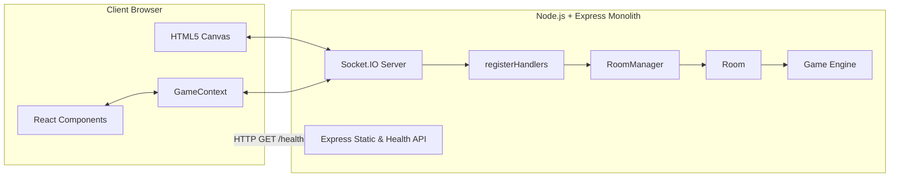

# Doodle Dash 🎨

> A fast, responsive, real-time multiplayer drawing and guessing game built with React, Node.js, Express, and Socket.IO. Inspired by skribbl.io.

---

## 🌐 Live URL

* **Production URL:** `https://skribbl-clone-1qyw.onrender.com`
* **Health Check:** `https://skribbl-clone-1qyw.onrender.com/health`

> **Note on Free-Tier Hosting:** Render free web services automatically spin down after inactivity. On initial visit after a period of idleness, please allow ~30–50 seconds for the service to wake up.

---

## 🚀 Features

### Core Implemented Features
* **Multiplayer Rooms & Lobbies:** Create public or private rooms with 6-character room codes, shareable invite links, and host-configurable settings (rounds, draw time, word count, hints, challenges).
* **Lobby Management:** Real-time player listing with status indicators, ready-up system, host start authorization gate, and host kick capability.
* **Session Reconnection:** Automatic tab-level session persistence (`sessionStorage`) that restores player state and canvas drawings on page refresh.
* **Public Room Discovery:** Browse and join active public lobbies directly from the landing page.
* **Real-Time Drawing Canvas:** Custom HTML5 canvas engine with normalized `[0, 1]` coordinates, brush sizing (thin/medium/thick), 12-color palette, eraser, undo, and clear canvas.
* **Authoritative Turn-Based Game Loop:** Strict server-side state machine managing turn rotations, timers, rounds, and game over sequences.
* **Word Selection & Secrecy:** Drawer picks from 1–5 category-based words. Words are never exposed to guessers over WebSockets until round end.
* **Guess Matching & Partial Distance:** Normalizes accents, punctuation, and casing; calculates Levenshtein distance for private "So close!" feedback on 1-letter typos.
* **Live Chat & Leaderboard:** Dynamic rank recalculation, active drawer indicators, guesser status badges, and combined guess/chat feed.

### Special Differentiators
* **Feature A — Drawing Challenge Cards (PRD §13.4):**
  * `TWO_COLORS`: Limits drawings to two distinct brush colors (server-enforced; swatches automatically disabled).
  * `ONE_STROKE`: Restricts drawer to a single continuous stroke; disables undo and clear (server-enforced).
  * `SPEED_DRAW`: Cuts drawing time in half with minimum 15s clamp (server-enforced).
  * `HONOR_NO_LETTERS`: Self-reported challenge with honor-system tag (no artificial points).
  * **Challenge Reward:** Drawer receives `+25` bonus points at round end if an enforced card is completed and at least one player guesses correctly.
* **Feature B — Progressive Hints (PRD §13.3):**
  * Reveals letter blanks progressively based on turn time schedules while ensuring at least half the word remains hidden.
* **Feature C — Streak Bonuses (PRD §13.5):**
  * Rewards players for consecutive correct guesses: `+0` (1st), `+20` (2nd), `+40` (3rd), `+60` (4th), capped at `+80` (5th+).

### Postponed / Not Implemented
* Multi-server Redis/horizontal scaling (designed for single-instance in-memory state).
* AI / machine-learning sketch verification (challenge cards rely on mathematical canvas event constraints or self-reporting).
* Persistent user accounts / database login (ephemeral guest nicknames only).
* Combination word mode and votekicking.

---

## 🛠️ Tech Stack

* **Frontend:** React 18, TypeScript, Vite, HTML5 Canvas 2D Context, CSS Variables (Custom Sticker-Book Design System).
* **Backend:** Node.js, Express, Socket.IO, TypeScript (`tsx` runner).
* **Testing:** Node.js built-in test runner (`node --test`), TypeScript typechecking (`tsc`).
* **Deployment:** Unified single-origin Express web service (Render / Docker / VPS).

---

## 🏗️ Architecture Overview

Doodle Dash runs as a single-origin monolith in production: Express serves both the REST endpoints (`/health`, `/api/rooms/public`), the built React bundle (`client/dist`), and the Socket.IO WebSocket server.



For in-depth sequence diagrams covering the drawing pipeline, state machine transitions, and secrecy model, see [docs/ARCHITECTURE.md](docs/ARCHITECTURE.md).

---

## ⚡ Socket.IO Event Contract

| Event | Direction | Payload | Description |
|---|---|---|---|
| `create_room` | C → S | `{ hostName, settings }` | Creates a new room; client becomes host. |
| `join_room` | C → S | `{ roomId, playerName, sessionId? }` | Joins an existing room or reconnects session. |
| `set_ready` | C → S | `{ ready }` | Toggles player readiness in lobby. |
| `start_game` | C → S | `{}` | Host initiates the game sequence. |
| `word_chosen` | C → S | `{ word, acceptChallenge? }` | Drawer selects word and challenge card response. |
| `draw_start` | C → S | `{ x, y, color, size, tool }` | Begins a new drawing stroke. |
| `draw_move` | C → S | `{ x, y }` | Streams stroke trajectory points. |
| `draw_end` | C → S | `{}` | Concludes current stroke. |
| `draw_data` | S → C | `{ type, strokeId, x, y, ... }` | Broadcasts stroke points to viewers (not drawer). |
| `draw_undo` / `canvas_clear` | S ↔ C | `{}` | Synchronizes canvas undo or full clear. |
| `guess` | C → S | `{ text }` | Submits guess during drawing phase. |
| `hint_update` | S → C | `{ mask, revealedCount }` | Progressive masked letter reveals to guessers. |
| `round_end` | S → C | `{ word, reason, scores, ... }` | Concludes turn, reveals word, distributes bonuses. |
| `game_over` | S → C | `{ winners, leaderboard }` | Concludes match with podium and final ranks. |

---

## 🎯 Game Rules & Scoring

### Base Guessing Points
$$\text{Base Points} = 100 + \left\lfloor 200 \times \frac{\text{Remaining Time}}{\text{Total Time}} \right\rfloor$$
* Guesses earn between **100 and 300 points** based on speed.
* The drawer earns **+50 points** for every player who guesses their word.

### Streak Bonus (Feature C)
| Streak Count | Turn Bonus |
|---|---|
| 1st guess | +0 pts |
| 2nd consecutive | +20 pts |
| 3rd consecutive | +40 pts |
| 4th consecutive | +60 pts |
| 5th+ consecutive | +80 pts (maximum cap) |

### Challenge Cards (Feature A)
| Challenge | Rule | Enforcement | Drawer Bonus |
|---|---|---|---|
| **Two Colors Only** | Use at most 2 distinct colors | Server-enforced; extra colors blocked | +25 pts |
| **One Continuous Stroke** | Draw without lifting brush | Server-enforced; undo/clear disabled | +25 pts |
| **Speed Draw** | Half standard turn time | Server-enforced countdown clamp | +25 pts |
| **No Letters/Numbers** | No alphanumeric symbols | Honor system (player integrity) | 0 pts |

---

## 💻 Local Setup & Development

### Prerequisites
* Node.js `>= 20.0.0`
* npm `>= 9.0.0`

### Installation
```bash
# Clone the repository
git clone https://github.com/your-username/doodle-dash.git
cd doodle-dash

# Install dependencies for both server and client
npm --prefix server install
npm --prefix client install
```

### Running Locally
```bash
# Option 1: Start both backend and frontend concurrently
npm run dev

# Option 2: Run backend and frontend in separate terminals
# Terminal 1 (Backend on port 3001):
npm --prefix server run dev

# Terminal 2 (Frontend on port 5173 with proxy to 3001):
npm --prefix client run dev
```

Open your browser to `http://localhost:5173`. Open an Incognito window to test real-time multiplayer between multiple tabs.

### Running Automated Tests
```bash
# Run backend test suite (48 pure-function & rule tests)
npm --prefix server test

# Verify client TypeScript compilation and bundle build
npm --prefix client run build
```

---

## 🚢 Deployment (Render)

This project is pre-configured for zero-friction single-service deployment on **Render**:

1. Push your repository to GitHub.
2. In the [Render Dashboard](https://dashboard.render.com/), click **New +** → **Web Service**.
3. Select your repository.
4. Configure the service:
   * **Name:** `doodle-dash`
   * **Region:** Any (e.g. Frankfurt, Oregon, Singapore)
   * **Branch:** `master`
   * **Runtime:** `Node`
   * **Build Command:**
     ```bash
     npm --prefix client install --include=dev && npm --prefix client run build && npm --prefix server install --include=dev && npm --prefix server run build
     ```
   * **Start Command:**
     ```bash
     node server/dist/index.js
     ```
   * **Plan:** Free
5. Click **Create Web Service**.
6. Once deployed, verify `https://<your-service>.onrender.com/health` returns `ok`.
