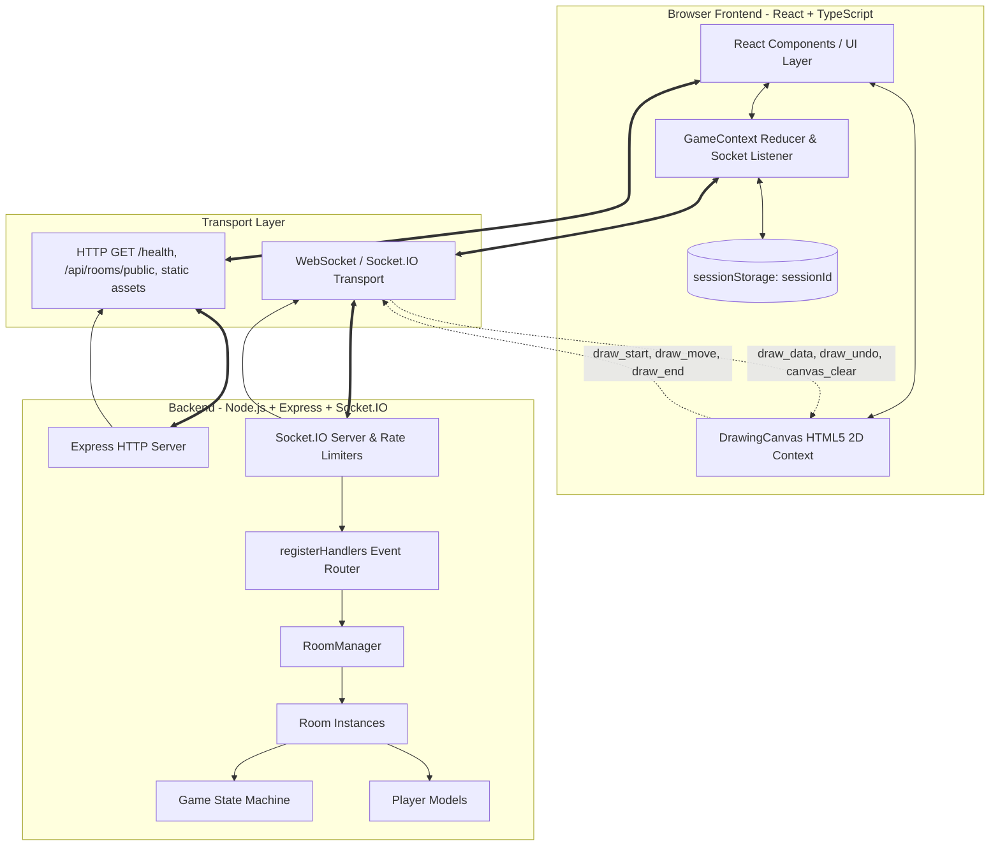
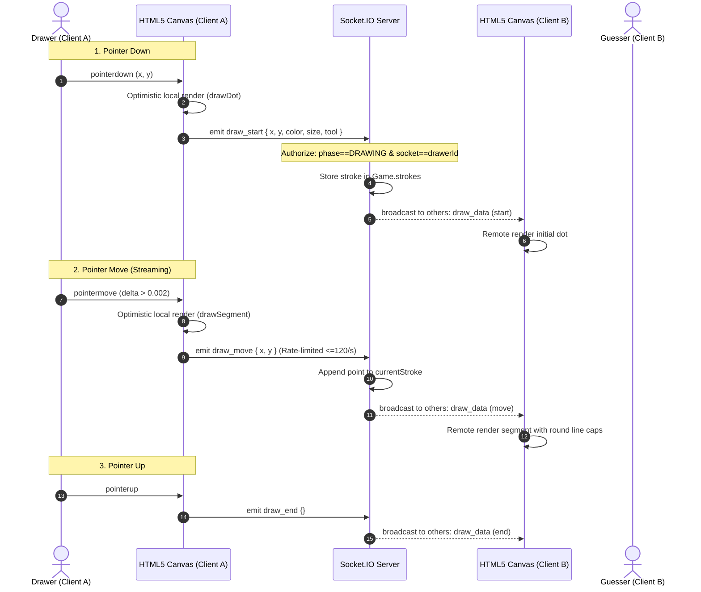
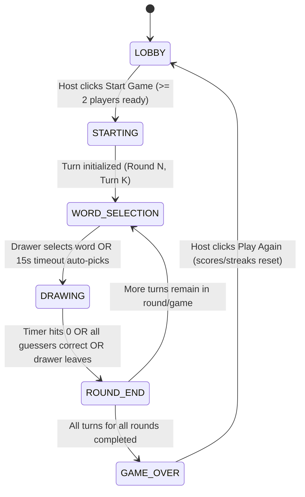

# Doodle Dash — Architecture Documentation

This document describes the architectural design, communication protocols, state management, and secrecy mechanisms of Doodle Dash, a real-time multiplayer drawing and guessing game built with React, Node.js, Express, and Socket.IO.

---

## 1. High-Level System Architecture



### Architectural Decisions & Rationale
1. **Single-Origin Monolith for Deployment:** The backend serves the built React frontend (`client/dist`) from the same Express instance. This removes all cross-origin CORS negotiation, cookie/session domain conflicts, and synchronization issues between separate frontend and backend deployments on platforms like Render.
2. **In-Memory Server State:** Rooms and game sessions are ephemeral. All room metadata, timers, player states, and strokes live in memory via OOP classes (`RoomManager`, `Room`, `Game`, `Player`), eliminating database overhead and latency.
3. **Session-Based Reconnection:** Player sessions are tracked using cryptographically random `sessionId` tokens stored in browser `sessionStorage`. If a player refreshes their tab or experiences momentary network failure, they automatically rebind to their existing player slot without duplicating lobby entries or resetting scores.

---

## 2. Drawing Pipeline & Canvas Synchronization

Strokes are captured, normalized, broadcast, and rendered using an optimistic local + round-trip remote approach:



### Critical Drawing Guarantees
* **Coordinate Normalization:** Coordinates are transmitted as normalized floats in the interval `[0, 1]`, mapped to a logical 800×600 canvas coordinate system. Clients scale smoothly to any screen aspect ratio without stroke distortion.
* **Non-Echoing Optimization:** `draw_data` is emitted to room members *excluding* the drawer (`socket.to(room.code)`). This completely prevents double-rendering, flickering, and synthetic lag on the drawing client.
* **Canvas Stroke Preservation:** On React re-renders, socket listeners maintain stable references (`useRef`), ensuring canvas contexts and active strokes are never cleared prematurely on state updates.

---

## 3. Game State Lifecycle & Phase Transitions

The game transitions through well-defined phases managed by the authoritative server `Game` class:



---

## 4. Guess Matching, Secrecy & Progressive Hints

```mermaid
flowchart TD
  GuessInput[Guesser sends 'guess' or 'chat'] --> PhaseCheck{Phase == DRAWING?}
  PhaseCheck -- No --> BroadcastChat[Broadcast as public chat_message]
  PhaseCheck -- Yes --> DrawerCheck{Is Sender Drawer?}
  DrawerCheck -- Yes --> BlockDrawer[Block if contains word; else chat]
  DrawerCheck -- No --> CorrectCheck{Already Guessed Correctly?}
  CorrectCheck -- Yes --> BlockGuess[Display to drawer/correct guessers only]
  CorrectCheck -- No --> MatchCheck{normalizeGuess(text) == normalizeGuess(word)?}
  
  MatchCheck -- Correct --> AwardScore[Award points + streak bonus + drawer points]
  AwardScore --> AnnounceCorrect[Broadcast 'Player guessed the word!' without word]
  AwardScore --> CheckAllGuessed{All connected guessers done?}
  CheckAllGuessed -- Yes --> EndTurnEarly[End turn early -> ROUND_END]
  CheckAllGuessed -- No --> KeepDrawing[Continue drawing countdown]

  MatchCheck -- Incorrect --> CloseCheck{Levenshtein distance <= 1 AND length >= 5?}
  CloseCheck -- Yes --> CloseHint[Private emit to guesser: 'So close!' not in chat]
  CloseCheck -- No --> BroadcastPublicChat[Broadcast as standard chat message]
```

### Word Secrecy Architecture
To prevent clients from inspecting WebSocket packets in DevTools to cheat:
1. **Targeted Emits (`io.to(drawerSocket)`):** The raw word and word selection options are dispatched exclusively to the drawer's socket ID.
2. **Dynamic Masking (`hints.ts`):** Guessers receive only masked representations (`_ _ _ _ _`) computed server-side.
3. **Scheduled Letter Reveals (Feature B):** At `drawTime * k / (h + 1)` intervals, the server reveals individual random character indices. The client only ever receives the resulting updated mask string (`hint_update { mask }`).
4. **Reveal on Round End Only:** The unmasked word is broadcast room-wide only in the `round_end` event after all scoring has closed.

---

## 5. Scoring & Streak Engine

* **Base Guesser Score:** `100 + floor(200 * remainingTime / totalTime)` (100 to 300 points based on speed).
* **Drawer Bonus:** `+50` points per correct guesser.
* **Streak Progression (Feature C):**
  * Turn 1: `+0` bonus
  * Turn 2: `+20` bonus
  * Turn 3: `+40` bonus
  * Turn 4: `+60` bonus
  * Turn 5+: `+80` bonus (maximum cap)
* **Challenge Card Reward (Feature A):** `+25` bonus points awarded to the drawer at round end if an enforced challenge was accepted and at least one guesser identified the word.
